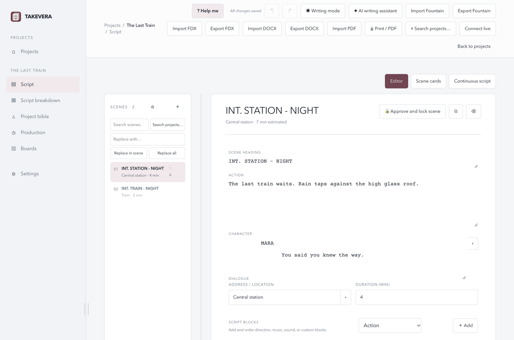

# Takevera

A local-first desktop workspace for writing scripts and preparing production books. Takevera brings scenes, shot lists, equipment, lighting and call sheets together for independent creators and small teams.



**Status:** version 0.1.2 beta is a development release. Download it from [GitHub Releases](https://github.com/loopman90/takevera/releases/tag/v0.1.2-beta.1) or visit the [project website](https://loopman90.github.io/takevera/). The project uses the MIT licence.

## Start here

1. Build or install an appropriate development package for your system; see [platforms and installation](#platforms-and-installation).
2. Open Takevera and choose **New project**. A new installation starts without projects.
3. Open **Script** and add a scene. Changes are saved locally.
4. Open **Production** for shoot days, shot lists, equipment, lighting and call sheets.
5. Select **? Help me** in the app to search instructions, learn about the current screen or open the full guide offline.

Read the [English beginner’s guide](docs/USER_GUIDE_EN.md) or [Nederlandse beginnershandleiding](docs/USER_GUIDE_NL.md).

## Features

- **Writing:** structured scenes, script blocks, character and location suggestions, scene cards, revisions and print/PDF output.
- **Production:** shoot days, call sheets, shot lists, equipment, tasks, budgets, and configurable production-book exports.
- **Visual planning:** moodboards, storyboards, lighting and sound references, plus fixture markers on a reference image.
- **Local-first:** local project files, automatic saves, backups and an independent full-project export.
- **Optional integrations:** Claude, Gemini, Grok, an OpenAI-compatible endpoint or separately installed local model server, and manually configured shared-folder or self-hosted realtime collaboration. Selected AI context is sent only after review and confirmation.
- **Guidance:** English and Dutch UI, a glossary and offline help.

These features are implemented in the development app; not every workflow has been independently validated on every platform. [Coverage and known limits](docs/SPEC_COVERAGE.md) and [technical reference](docs/TECHNICAL_REFERENCE.md) describe details and format restrictions.

## Platforms and installation

The [0.1.2 beta release](https://github.com/loopman90/takevera/releases/tag/v0.1.2-beta.1) provides macOS DMGs and portable Windows and Linux test packages. Verify downloads using the included SHA-256 checksums.

| Platform | Current state |
| --- | --- |
| macOS 13+ | Apple Silicon and Intel packages can be built. Local builds are ad-hoc signed, without Apple Developer ID signing or notarization. Intel hardware testing remains outstanding. |
| Windows x64 | An unsigned portable test archive passed an automated Windows startup check. It is not an installer; interactive testing remains needed. |
| Linux x64 | The platform-built portable test archive passed an automated Linux startup check. Interactive use across distributions needs further validation. |

macOS development build: open the DMG and drag Takevera to Applications. Keep an independent backup before replacing an existing installation. There is no automatic update service.

### Opening a macOS build

The open-source macOS build does not require a paid Apple Developer account. An ad-hoc signature does not establish the developer’s identity, and the build is not notarized by Apple. macOS may block it on first launch. The current release is a beta and requires further testing.

If a release is obtained from the official project source and you have independently checked that it is the expected, unmodified file, first try to open the app. If macOS blocks it, **System Settings → Privacy & Security** may offer **Open Anyway** for that app. Follow [Apple’s instructions and security guidance](https://support.apple.com/en-us/102445). Do not override a warning that identifies malware or a damaged or modified app. Availability and wording vary by macOS version and device management.

## Configuration and privacy

Projects are stored under the user's Documents/Takevera directory by default; an existing legacy ScriptStudio folder may continue to be used. Use **Settings** to change the folder, interface language, appearance and optional services. Do not commit project data or API keys. The app supports PNG, JPEG and WebP references; linked originals need to remain available.

AI setup offers Claude, Gemini and Grok with preset endpoints, plus custom chat-completions endpoints and local servers. Live requests to the new provider integrations have not yet been tested with real API keys. Enter a model available to your account and an API key when required. An external provider receives the reviewed project context after confirmation and may charge for usage. A local server must be installed separately. Linux credential storage needs a supported secure secret store. See the [guides](docs/USER_GUIDE_EN.md) for steps and limitations.

## Development and builds

Use Node.js 22.13+ or 24+, npm, and the lockfile:

```sh
npm ci
npm start
npm test
npm run build:renderer
```

On macOS, `npm run test:smoke` and `npm run test:storage` run isolated Electron checks. Build a local macOS package with `npm run dist:mac` for the current architecture or `npm run dist:mac:x64` for Intel. Windows has an unsigned portable test builder and a manual Windows CI workflow; the public ZIP is not an installer. Linux x64 has a portable test builder and a manual Linux CI workflow; it is not an installer or AppImage. A build succeeding on one machine does not verify runtime behaviour on another platform. macOS release signing and notarization require developer credentials and separate approval; never commit them. See the [technical reference](docs/TECHNICAL_REFERENCE.md).

## Website and screenshots

The [English-first GitHub Pages site](https://loopman90.github.io/takevera/) is maintained under [website/](website/). It uses genuine app screenshots from a fictional isolated demo.

```sh
node website/build.mjs
node website/check.mjs
python3 -m http.server 4173 --directory website/dist
```

Open `http://127.0.0.1:4173/` locally. Review screenshot privacy and rights before publishing. The site has a manual-only deployment workflow; repository and Pages publication require separate approval. See [website/README.md](website/README.md).

## Contributing and project direction

See [CONTRIBUTING.md](CONTRIBUTING.md), [SECURITY.md](SECURITY.md), [CODE_OF_CONDUCT.md](CODE_OF_CONDUCT.md), [ROADMAP.md](ROADMAP.md) and [CHANGELOG.md](CHANGELOG.md). The latest full dependency audit reported no vulnerabilities; recheck before release. See [dependency security](docs/DEPENDENCY_SECURITY.md) for build details and limitations.

## Licensing

The owner selected the [MIT licence](LICENSE) and identified Astrid Roel as copyright holder. The owner confirmed 2026, the public contact details and rights to the provided logo and sample content. Third-party licence obligations still require review. Bundled font licences are in [src/fonts/](src/fonts/); see [THIRD_PARTY_NOTICES.md](THIRD_PARTY_NOTICES.md) for dependency notices and outstanding review.

### Equipment bookings and planning

Track individual physical equipment units and enter bookings with local start and end times in Production → Equipment list. Takevera flags overlapping or incomplete entries; scene assignments do not automatically create bookings. Review availability, preparation time and timeline warnings in the shoot day overview. Import previews describe recognised script content and limitations, and FDX/DOCX exports are read back and checked. Check formatting in the destination application. See the included user guides for details.

### Windows x64 test package

On Windows x64, run `npm ci` and `npm run build:windows:test`. The portable ZIP and its SHA-256 checksum are written into a new `dist/windows-test-*` folder. Extract the whole archive before opening `Takevera.exe`. The ZIP is unsigned and Windows may warn or block it. This is a test package, not an installer. The manually started GitHub Actions workflow `.github/workflows/windows-test.yml` runs checks on a Windows runner and uploads a temporary artifact; it does not publish a release. The 0.1.2 platform-built package passed its automated startup check; further interactive testing is needed. Windows OCR for scanned PDFs is not implemented; selectable PDF text remains supported.

### Linux x64 test package

The Linux x64 test archive is portable, not an installer. Extract the whole archive and run `./takevera` from the extracted folder on a graphical desktop with a working Chromium sandbox. It is built and checked by the manual `linux-test.yml` workflow. Linux desktop distributions and credential stores vary; interactive testing remains necessary. Local OCR for scanned PDFs is unavailable on Linux.
